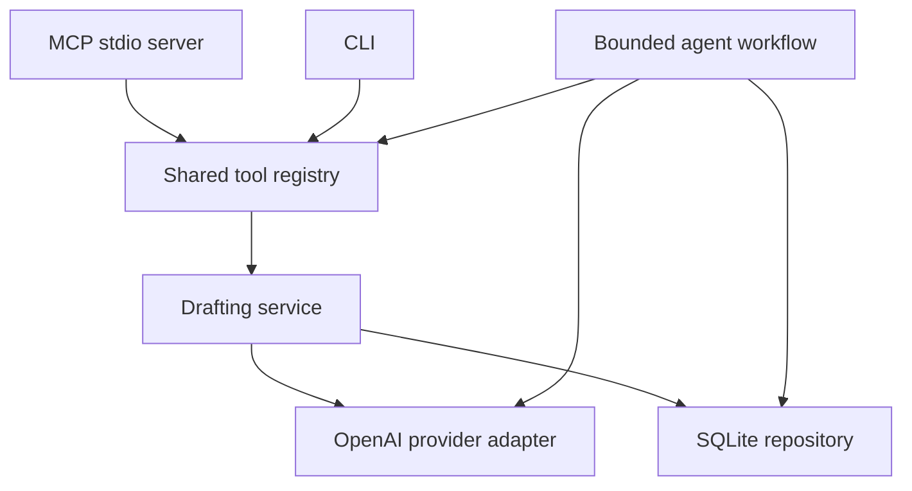

# Architecture

Milestone one is a single-owner, local Node 24 application. MCP, CLI, and the bounded agent workflow call the same application tools; drafts and execution history are durable in SQLite. There is no LinkedIn integration.

Milestone 1.5 extends this baseline with a private file-based knowledge index, bounded retrieval and evidence-linked draft review. See [the extension architecture and tradeoffs](milestone-1.5.md) for the current generation contract and privacy boundaries.

Milestone 2 adds a fixed research workflow alongside drafting, with official release ingestion, deterministic scoring, and persistent review-required ideas. See [the release-to-idea architecture](milestone-two.md).

Milestone 2.5 connects accepted ideas to the shared drafting service with application-owned public research attachments, separate public citations and private knowledge, review revision checks, and retained blocked artifacts. Acceptance authorizes generation only; every draft still requires human review. See [the research-to-draft workflow](milestone-2.5.md).

## Boundaries and choices

| Layer                | Responsibility                                                                                       |
| -------------------- | ---------------------------------------------------------------------------------------------------- |
| `src/domain`         | Zod input/output contracts, errors, provider interfaces; no SDK, transport, or database dependencies |
| `src/application`    | Shared tools, drafting, permissions, and bounded workflows; no MCP/CLI dependencies                  |
| `src/infrastructure` | OpenAI Responses adapter, SQLite repository, configuration, sanitized stderr logs                    |
| `src/entrypoints`    | Composition, MCP protocol and CLI adapters                                                           |

The official MCP SDK v2 supplies stdio protocol handling (`@modelcontextprotocol/server` 2.3.1; client 2.0.0 for tests and smoke verification). The official OpenAI SDK 7.15.0 supplies Responses, structured outputs, strict tool calling, timeouts, and bounded transport retries. Zod validates model and caller output locally; the model's schema is not sufficient proof of a valid draft. TypeScript uses strict checking. Stable dependency releases are pinned in the lockfile.

Two implementation deviations preserve the service architecture. SQLite uses `node:sqlite` because the available offline environment could not obtain the proposed `better-sqlite3` native addon. Node 24's built-in driver has release-candidate status, so the supported runtime is restricted to 24.16+ within 24.x and SQL stays behind one repository boundary. A minimal JSON stderr logger replaces unavailable Pino and records only allowlisted operational fields. These decisions avoid native-download failures and permit actual persistence/protocol tests; neither introduces a second persistence or logging pathway.

## Generation, identity, and history

Configuration provides one local user identity and optional interests, audience, tone, language, and writing samples. Explicit request preferences override defaults. Each draft records a profile snapshot and normalized input with `user_provided` origin. This provides lightweight generation provenance, not an evolving memory system or permission to import restricted data.

The drafting handler validates input, reserves an execution, calls the provider outside any database transaction, validates `{ body, warnings }`, independently assesses the immutable body against the same evidence snapshot, verifies proposed evidence links locally, and atomically commits the draft and completed execution result. The application assigns IDs, timestamps, user/run IDs, metadata, and `draft` status. Models cannot assign identity, idempotency keys, approvals, or verified external outcomes.

SQLite uses numbered transactional migrations, parameterized SQL, foreign keys, WAL, and a busy timeout. Its tables hold drafts, runs, tool executions and separate blocked review artifacts. Valid bodies from rejected or failed assessments are committed atomically with failed execution status. Local persistence is not encrypted; operators must protect files and backups.

Basic idempotency uses a unique reservation associated with normalized request content, profile, model, and generation versions. Agent requests reserve their key before stochastic planning, so matching completed replays do not call the model again. Direct and agent requests share the user/key namespace; reusing a key across modes conflicts. Mismatched input under an existing key conflicts; pending or failed executions require an explicit new-key retry. Draft and its tool result commit together. Advanced leases, distributed locking, and resumption of interrupted workflows are deferred. Completed persistence survives response-delivery failure, but idempotency cannot eliminate uncertain provider billing after network interruption.

## Bounded agent and future tool selection

The agent accepts a natural-language brief and offers the provider a structured definition from the shared tool registry. Milestone one permits exactly one proposed `draft_post` invocation and disables parallel calls. The original brief remains authoritative; the proposed brief is retained in audit history but cannot introduce new source facts. Explicit caller preferences override proposed audience, tone, and language; null proposals fall back to profile defaults. The application validates the proposal and executes the same handler as MCP, then returns the actual persisted result without another generated summary. Refusals, incomplete responses, unknown tools, excess calls, invalid arguments, and permission violations fail explicitly.

The provider interface accepts a list of tool specifications rather than embedding a second drafting implementation. Future workflows can reason about research topics and select registry tools dynamically under runtime allowlists and budgets. A planner never defines its own permissions. No generic orchestration engine, multi-agent loop, vector store, or durable scheduler is introduced now.

The default overall execution deadline is 120 seconds. Provider requests use an explicit 30-second timeout and at most two SDK transport retries within the execution deadline. Cancellation reaches both generation and assessment calls. Direct drafting uses two logical calls; agent drafting adds a planning call. Refusals and invalid generated content do not trigger silent draft substitution.

## Permissions and expansion

Shared tools declare `read_local`, `draft_local`, or `delete_local` permission requirements. Application composition supplies execution permissions; model arguments cannot grant them. Drafting can incur provider costs and local writes, but no publication approval is needed because no social action exists.

Before external social actions, add a persistent approval service binding the account, target, exact payload, draft revision, and expiry. A payload edit invalidates approval. Agents and ordinary MCP callers cannot approve themselves. Adapter capability checks must establish product access, scope, policy permission, and permitted data use separately. Ambiguous transmission is an unknown outcome requiring reconciliation, never an automatic successful action or blind retry.

Next increments are authorized-source research with enforced provenance/retention, preferences and a content calendar, recurring local workflows, then manual handoff and persistent approvals. LinkedIn integration follows only capabilities and agreements actually granted. Redis queues, Temporal, multi-user hosting, HTTP MCP, and hosted tracing require a concrete usage reason before adoption. See [LinkedIn boundaries](linkedin-boundaries.md).
